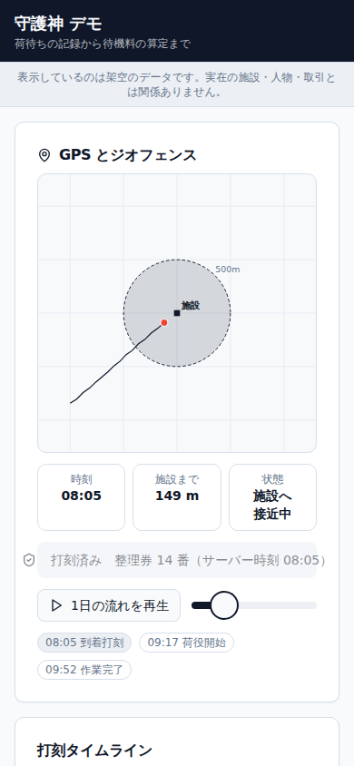
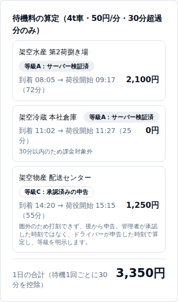
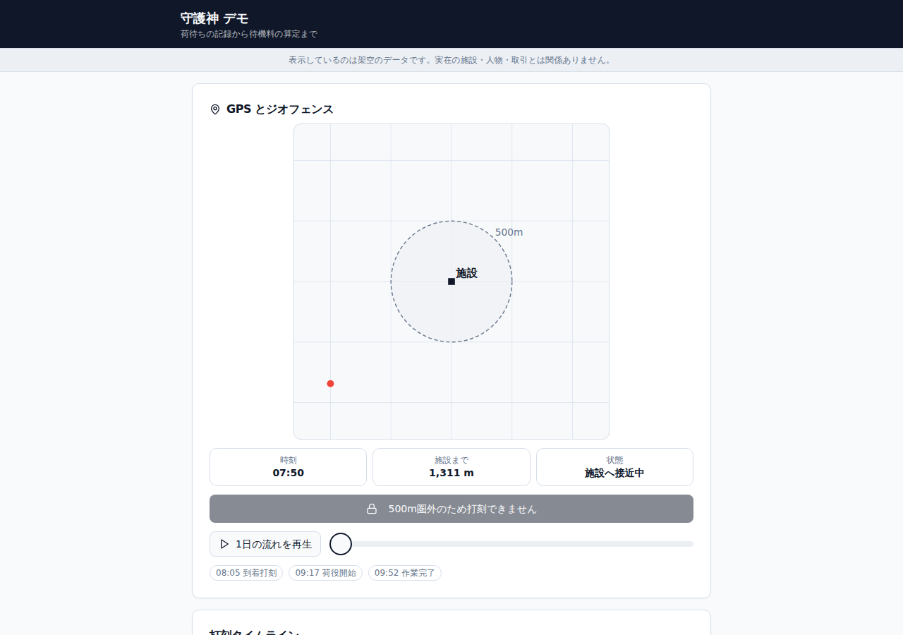
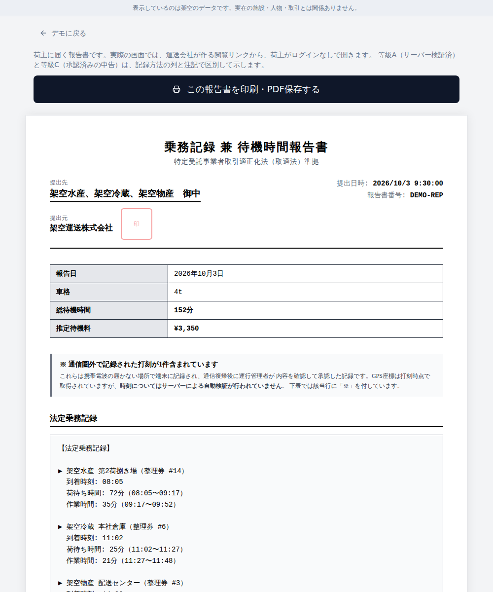

# 守護神（shugoshin-logbook）

トラックドライバーの**荷待ち（待機）時間を、改ざんしにくい形で記録し、待機料の根拠にする**アプリです。
2024年問題・物流法（いわゆる取適法）で、荷主施設での待機時間を客観的な証拠として残す必要が出たことが出発点です。

- 🔗 **デモ**: `/demo`（ログイン不要・架空データ・DBには接続しません）。日報の提出（`/demo/daily`）→ 荷主向けの報告書（`/demo/report`）まで通して試せます
- 技術: React 18 / Vite / TypeScript / Tailwind / shadcn-ui / Supabase（Auth・Postgres・Edge Functions）/ PWA

## 画面（`/demo`・架空データ）

| 施設の500m圏内で到着を打刻 | 待機料の算定 |
|---|---|
|  |  |
| 圏外では打刻ボタンが無効になり、圏内に入って打刻すると整理券番号とサーバー時刻が表示されます。 | 30分を超えた分のみ、待機1回ごとに30分を控除して合計します。承認済みの申告は「等級C」と明示します。 |

| PC幅（再生バーで1日の流れを動かせます） | 荷主に渡す報告書（印刷・PDF保存） |
|---|---|
|  |  |

画像は `/demo` を撮ったもので、施設・運送会社・金額はすべて架空です。時刻は端末の設定に関係なく日本時間で表示します。

## 何ができるか

| 利用者 | できること |
|---|---|
| ドライバー | 施設の500m圏内で到着を打刻 → 荷役開始 → 完了。圏外・電波なしでは「仮記録」を残し、後で管理者が承認 |
| 運送会社の管理者 | 圏外申請の承認、日報・月次の待機リスク帳票、組織・招待コードの管理 |
| 荷主の管理者 | 自社施設の待機状況（カンバン）で呼出・荷役開始を操作 |
| 共通 | 音声・テキストからの発注書面（4条書面）作成、水産物の漁獲番号の入力補助 |

## 「改ざんしにくい」をどう作っているか

打刻データは待機料の算定根拠になるため、**クライアントを信用しない**設計にしています。

1. **時刻はサーバーが決める**: 到着・荷役開始・完了の時刻は DB のサーバー時刻。端末の時計は使いません。
2. **書き込みは RPC だけ**: 証拠のテーブルへの直接書き込みは権限ごと外し、`SECURITY DEFINER` の関数（`issue_ticket` / `start_loading` / `complete_ticket` / `cancel_ticket`）だけを入口にしています。
3. **ジオフェンスは二重**: 画面側でボタンを無効化し、サーバー側のトリガーでも 500m 圏外を拒否します。
4. **確定したら変えられない**: 完了時に証拠を署名（`is_signed`）し、署名済みの行の更新・削除はトリガーで禁止します。取消は物理削除せず状態の変更のみ。
5. **例外は区別して見せる**: 圏外の申告は管理者の承認を経た「等級C」として、通常の「等級A」と分けて帳票に出します。算定には申告時刻を使い、承認した時刻は使いません。
6. **待機料の算定**: 30分を超えた分のみ、**待機1回ごと**に30分を控除して合計します（`src/lib/waitCostCalc.ts`）。

設計の詳細は [`docs/`](./docs) にあります。

## セットアップ

```sh
npm ci
cp .env.example .env   # 値は下記
npm run dev
```

| 変数 | 内容 |
|---|---|
| `VITE_SUPABASE_URL` | Supabase プロジェクトの URL |
| `VITE_SUPABASE_PUBLISHABLE_KEY` | 公開（anon）キー。**service_role キーは入れないこと** |

```sh
npx tsc --noEmit -p tsconfig.app.json   # 型チェック
npx vitest run                          # テスト
npm run build                           # 本番ビルド
```

DB は `supabase/migrations/` のマイグレーションで管理します（`CLAUDE.md` の規約: コンソールからの直接変更はしない）。
Edge Function の `parse-order` / `parse-daily-report` / `generate-order-pdf` には `GEMINI_API_KEY` が必要です。

## ディレクトリ

```
src/pages/          画面（Demo, CheckIn, AdminDashboard, PendingPunches, Report ...）
src/hooks/          useEvidence（打刻）, useAuth, useDailyTimeline ...
src/lib/            算定・変換のロジック（単体テスト付き）
src/demo/           /demo 用の架空データ
supabase/migrations 変更履歴（DB のスキーマ・RLS・RPC）
supabase/functions  Edge Functions
docs/               設計メモ・実装要約・進捗ログ
```

## 現在の状態とロードマップ

**できている**: ドライバーの打刻〜日報、圏外の仮記録と承認、荷主カンバン、月次帳票、`/demo`、CI（型・テスト・ビルド）。

**意図的にまだ作っていないもの**:
- 施設・荷主組織の登録 UI（現在は SQL シードでの運用）と、荷主による施設の所有確認フロー
- 請求書の発行・インボイス対応、帳票の荷主への送達
- 荷主への到着通知、完了の押し忘れ通知
- 料率表・水産法の対象魚種の DB 管理（現在はコード内の定数）

**テスト状況**: `npx vitest run` で 13 ファイル・118 件が成功、型チェック（`npx tsc -p tsconfig.app.json --noEmit`）はエラーなし（2026-10-13 実測。単体・コンポーネントテストのみ）。

## 既知の課題

- **E2E テストは未実施**です。上記のテストは単体・コンポーネントテストで、ブラウザを通した通し確認の自動化はありません。
- **現場（実際のドライバー・荷主）への聞き取りは未実施**です。画面や運用フローは、現場の意見で検証されていません。
- **法務の目通しも未了**です。帳票や書面（4条書面など）の文言は、取適法の項目に沿って作った記載例であり、法的な有効性・適合性を保証するものではありません。
- **待機料の料率は仮定の値**です。車格別の単価（2t: 40円/分、4t: 50円/分、10t: 60円/分）は `src/lib/waitCostCalc.ts` のコード内定数で、実際の契約や公的な基準から取った値ではありません。デモ・帳票の金額は、この仮定に基づく試算です。
